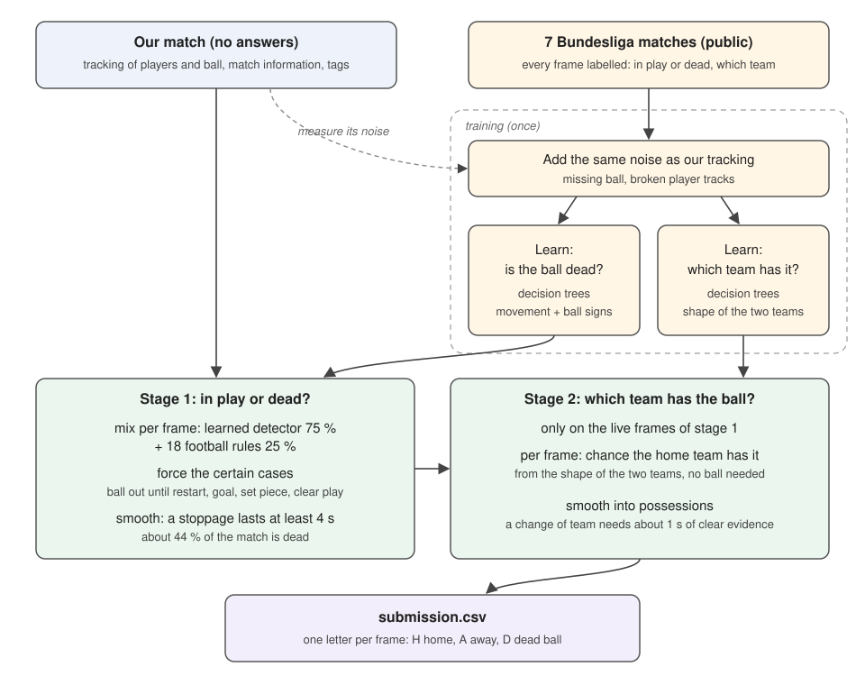

# How the model works

This page explains the model from scratch, for a reader who has not seen the project before. The exact
settings are in [PARAMETERS.md](PARAMETERS.md), and every step with its input files is in
[PIPELINE.md](PIPELINE.md).

## The task

The match (FC Barcelona against Athletic Club) is a video of 199,319 frames, 25 frames per second. For
every frame we write one letter:

- `H`: the home team (Barcelona) has the ball,
- `A`: the away team (Athletic) has the ball,
- `D`: the ball is dead (out of play, a foul, a goal celebration, half-time ...).

We do not watch the video. We read three files from the organisers:

- the **tracking file**: the position of every player and of the ball in every frame. It is noisy: the
  ball is missing on many frames, and a player's track often breaks into pieces;
- the **match information file**: the two teams, the goalkeepers and which way each team attacks;
- the **tag file** (Smart Tagging): marks made by the data provider for set pieces, goals and kick-offs.

No answer for this match is ever given to the model.

## Where the model learns from

The model learns from **seven other professional matches**: the open data of the German Bundesliga,
published by the league (DFL) and free to download. In those matches every frame already says whether
the ball is in play and which team has it. That is exactly the answer we need, but for other games.

There is one problem. The Bundesliga tracking is clean, and our match's tracking is not. A model trained
on clean data would be confused by ours. So before training we **make the Bundesliga matches look like
our match**: we measure, on our match's tracking alone, how often the ball goes missing, for how long,
and how often player tracks break, then we damage the Bundesliga data in the same way. The model then
trains on data that looks like the data it will have to label.

## The pipeline at a glance

The same in words: we **first find when the ball is dead**, and only then **decide which team has it**
during the live stretches that are left.

## Stage 1: is the ball in play or dead?

For every frame, two independent opinions give a chance that the ball is dead:

1. **The learned detector.** A decision-tree model (gradient boosting: many small decision trees added
   together) trained on the damaged Bundesliga matches. It looks at how the players move and stand and at
   simple ball signs, now and 1 and 2 seconds later. The seconds after a whistle often show that there
   was one: everyone slows down and walks.
2. **Eighteen football rules.** Simple signs, each with a fixed weight chosen from the Laws of the Game:
   everyone is walking, the ball is outside the lines, the ball is still, the players stand as for a
   corner kick or a free-kick wall, a goal was just scored, someone is sprinting (a sign of live play),
   and so on.

The model mixes them: 75 % the learned detector, 25 % the rules.

Some situations need no opinion, because the tracking shows them clearly. We **force** them:

- *Certainly dead*: before each kick-off; the ball out of the pitch until the restart is taken; from a
  goal to the next kick-off; a tagged set piece until it is taken; the ball standing still for 2 s.
- *Certainly in play*: a fast ball inside the pitch while players sprint; the 2 s after a restart kick;
  the goalkeeper holding the ball in his penalty area.

Per-frame chances jump around, and a real stoppage is never a fraction of a second long. So a
**smoothing step** chooses the most likely clean sequence of "dead" and "in play" stretches: a stoppage
lasts at least 4 s, and every switch between the two must be worth its cost. (The method is a standard
one, the Viterbi algorithm.) It is set so that the ball is dead for about 44 % of the match, a typical
value, close to the Bundesliga matches.

Last, three tidy-up rules:

- each possession is stretched by 1 s into the stoppage next to it, because the scoring punishes a
  possession that is too short more than one that is a little too long;
- a sliver of play of 1 s or less between two stoppages becomes dead;
- *the goalkeeper rule*: while a goalkeeper holds the ball, the ball often disappears from the tracking
  and everyone walks, which looks like a stoppage. If the keeper then throws or kicks the ball hard and
  someone runs after it, that moment was live play, and it is set back to in play.

## Stage 2: who has the ball?

Stage 1's dead frames are now fixed. What is left are the **live stretches**, and for each frame in them
we only need to choose between home and away.

**The team model** gives, for every frame, the chance that the home team has the ball. It does not use
the ball at all, because in our match the ball is too often missing. It looks only at the **shape of the
two teams**: where each team's players are, how long and wide the team is, how fast it moves and whether
it moves towards the opponent's goal. A team with the ball pushes forward and spreads out; a team without
it falls back and closes the gaps. It is three decision-tree models averaged. During training every frame
is also shown with the two teams swapped, so the model learns what having the ball looks like, and not
"the home team usually has the ball".

**Smoothing into possessions.** Again, per-frame chances jump around. The same smoothing step turns them
into whole possessions: the ball only changes team when the evidence for the other team is clear for
about 1 s, and every possession lasts at least half a second. A deflection or a short tussle that does
not change which team is attacking does not change possession.

## What counts as a possession

- **Loose balls and challenges**: possession changes when the other team starts to behave as the team
  with the ball, for about a second.
- **Restarts** (throw-ins, corners, free kicks, goal kicks): the ball is dead from the moment it leaves
  the pitch, or play visibly stops, until the restart is taken. Who has it afterwards is decided by the
  team model, as everywhere else.
- **Stoppages without a visible cause** (fouls, whistles): seen when everyone slows down to walking, or
  from the shapes players take for set pieces.
- **Goals**: dead from the ball entering the goal until the next kick-off.

## Same result every time

Every random choice comes from one fixed number (the seed), the number of computer threads is fixed,
and the model outputs are rounded the same way on every machine. Running the repository on the same data
gives the same file, byte for byte. See [REPRODUCIBILITY.md](REPRODUCIBILITY.md).

## Where each part is in the code

| part | code | settings in `configs/default.toml` |
|---|---|---|
| reading the files | `lib/possession/io/` | `[paths]` |
| damaging the Bundesliga matches | `lib/possession/degradation/` | `[dfl]` |
| signs and features per frame | `lib/possession/features/` | `[stage1.cues]` |
| the learned dead-ball detector | `lib/possession/models/deadball_head.py` | `[stage1.head]` |
| the 18 football rules | `lib/possession/features/deadball.py` | `[stage1.cue_rules]` |
| the certain rules | `lib/possession/rules/` | next to each rule |
| the smoothing step | `lib/possession/decoding/` | `[viterbi]` |
| stage 1 and stage 2 | `lib/possession/pipeline/stage1.py`, `stage2.py` | `[stage1]`, `[stage2]` |
| the team model | `lib/possession/models/team_model.py` | `[team_model]` |
| training and labelling, start to end | `train/train.py`, `inference/predict.py` | |
