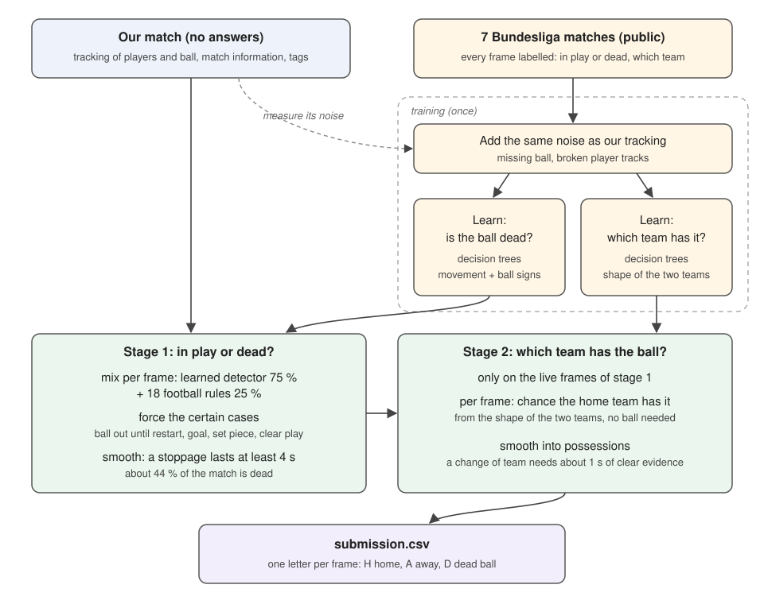

# Technical report

For every frame of FC Barcelona against Athletic Club (199,319 frames, 25 per second), the model writes
`H` (Barcelona has the ball), `A` (Athletic has the ball) or `D` (the ball is dead). It reads only the
organisers' tracking file, match information file and tag file.



## 1. Approach

The model answers two questions, one after the other, because each needs different evidence.

**Stage 1: is the ball in play or dead?** Most stoppages are visible in the tracking: the ball leaves the
pitch, stops, or disappears at a line; the players slow down and walk; they stand in the shapes the Laws of
the Game prescribe for a kick-off, a corner, a free-kick wall or a throw-in. For each frame, two opinions
give a chance that the ball is dead:

- a **learned detector**: decision trees (gradient boosting) trained on seven Bundesliga matches, which
  read how the players move and stand and simple ball signs, now and 1 and 2 seconds later;
- **18 football rules**, each with a fixed weight (everyone walking, the ball outside the lines, a corner
  formation, someone sprinting as a sign of play, ...).

They are mixed 75 % / 25 %. Cases that the tracking shows clearly are then forced: the ball out of the pitch
until the restart, a goal until the next kick-off, a tagged set piece until it is taken, clear fast play.
Last, a smoothing step (the Viterbi algorithm) picks the most likely clean sequence of stoppages and play:
a stoppage lasts at least 4 s, and about 44 % of the match is dead, a typical value, close to the
Bundesliga matches.

**Stage 2: which team has the ball?** Only the live frames of stage 1 are left. A second learned model
gives, for every frame, the chance that the home team has the ball. It reads only the **shape of the two
teams**: where they are, how long and wide, how fast they move and whether they move towards the
opponent's goal. A team with the ball pushes up and spreads out; a team without it falls back and closes
the gaps. It does not need the ball, which is missing on many frames of this match. The same smoothing step
turns these chances into whole possessions: the ball changes team only after about 1 s of clear evidence
for the other team.

**Why this design.** The ranking metric (spellF1) rewards whole possessions, so the smoothing matters as
much as the per-frame models: too many short possessions are punished, and so is merging real ones. Rules
that follow the ball (the organisers' nearest-player baseline) fail when the ball is missing; team shape is
there on every frame. Both learned models are trained on public Bundesliga data that has exactly the
labels we need, after adding the same noise as our match's tracking (missing ball, broken player tracks),
measured on our match without any labels, so that what they learn transfers.

A longer plain-language explanation: [MODEL.md](MODEL.md). Every step with its files:
[PIPELINE.md](PIPELINE.md).

## 2. Assets

**Used.** The tactical tracking of players and ball, and its match information file (teams, goalkeepers,
attack direction). From the tag file (Smart Tagging): the set-piece and goal windows (stoppages and rules)
and the kick-off tags (to find each kick-off).

**Not used.** The tactical and broadcast videos, the homographies, the broadcast tracking, and the team-phase
tags of the tag file (build-up, defending, ...).

## 3. Training data

| dataset | source | labelled by | amount | used for |
|---|---|---|---|---|
| DFL open data, German Bundesliga (Bassek et al. 2025, CC BY 4.0) | figshare 28196177 | the data provider: for every frame, ball in play or dead (BallStatus) and which team has it (BallPossession) | 7 matches, about 13 h of play; one frame in 15 used | both learned models |

None of it comes from the provided game. The pipeline reads no label of the provided game. Sources and
checksums: [DATA.md](DATA.md).

## 4. Possession rules implemented

- **Dead ball** starts when the ball is clearly out (more than 0.25 m beyond a line), stops for 2 s,
  disappears at a line while the players slow down, when a player stands more than 1 m beyond a line while
  the ball is slow, when everyone stands nearly still for 3 s, at a goal, or where the players slow down
  together as after a whistle. It ends at the restart: a still ball kicked inside the pitch, a throw-in or
  corner taken from the line, a set-piece formation breaking up, or the ball clearly in play again while
  players run. Before the kick-off, half-time and after the final whistle are dead.
- **Restarts**: no team is given the ball at a restart; the team model decides from the first frames of
  play, as everywhere else.
- **Loose balls and challenges**: possession changes only after about 1 s of clear evidence for the other
  team, and every possession lasts at least 0.5 s. A deflection or a short tussle that does not change which
  team is attacking does not change possession; a ball in the air belongs to the team that is still
  attacking.
- **Goalkeeper holding the ball** (the tracking often loses the ball then, and everyone walks): play, when
  the keeper then throws or kicks the ball hard and someone runs after it.

## 5. Limitations

- **Goalkeeper catches are the largest source of error.** When the keeper catches the ball, the play slows
  down and the ball is often lost by the tracking: the frames look like a stoppage and can be labelled dead.
  A rule that follows the keeper and the ball together (they move with a high correlation and at a similar
  speed) would recover most of these frames.
- **No ball model.** The team model does not use the ball, because the ball is missing on many frames of
  this match. With more time and more matches, we would train a ball tracker and add ball features to both
  models.
- **Referee whistle.** We tested an audio detector for the referee's whistle, which leaves a very distinct
  trace in a spectral analysis of the sound. It would mark stoppages that the tracking shows only late
  (fouls, offsides, ...). It is not part of the submission. It is the cheapest next step: a few other matches
  would be enough to train it.

## 6. Reproduction

Python 3.14.3; every package is pinned in `requirements.txt`. Put the organisers' three match files in
`data/tactical/` (or set `MTAH_DATA_DIR` to the folder that contains `tactical/`), then:

```bash
pip install -r requirements.txt && pip install -e .
python scripts/reproduce.py
```

The script downloads the public Bundesliga data (about 2.6 GB), checks every input file, trains both models
(about 30 minutes), labels the match and checks that `outputs/submission.csv` is byte-identical to the
submitted file (SHA-256 `46c69c3e559135a0e716eb316b67f13c953f1fc18378b3bace57fda242c21716`). The same steps
one by one, and the details of the environment: [REPRODUCIBILITY.md](REPRODUCIBILITY.md).
